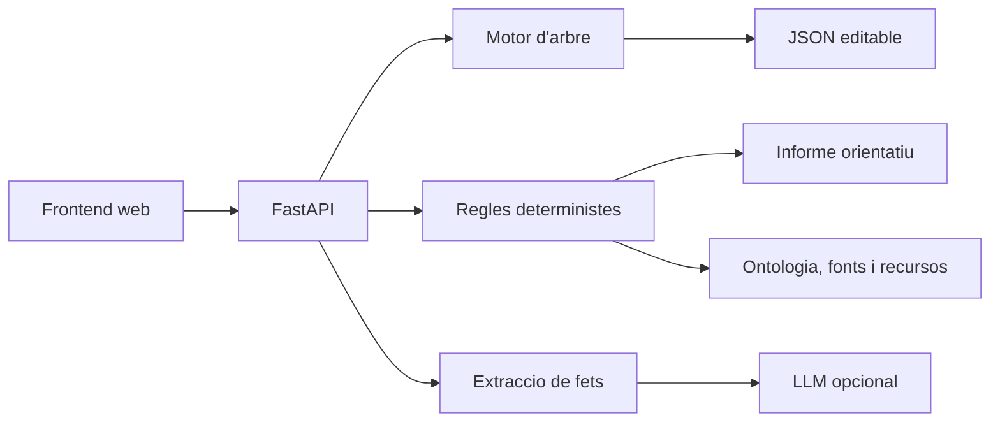

# LUCERNA 65 - Sistema

## Objectiu

LUCERNA 65 ajuda professionals a explorar indicadors que poden quedar amagats en situacions de violencia masclista envers dones de 65 anys o mes. El sistema no decideix ni certifica violencia: ordena preguntes, registra fets confirmats, mostra indicadors prudents i prepara un informe revisable.

## Arquitectura

## Components

- `backend/tree_engine.py`: crea sessions efimeres, selecciona la pregunta actual, encola branques i manté traça d'auditoria.
- `backend/rules.py`: converteix respostes en indicadors, prioritat orientativa, recomanacions, fonts i preguntes pendents.
- `backend/text_analysis.py`: extreu fets confirmables de text lliure. Sense LLM aplica heuristica conservadora.
- `backend/report.py`: genera l'informe estructurat i revisable.
- `content/questions/ca/tree.json`: arbre bilingue editable, amb `label_ca` i `label_es`.
- `content/ontology/*.json`: indicadors, recomanacions i fonts.

## Flux API

- `GET /api/health`
- `GET /api/capabilities`
- `POST /api/session/start`
- `POST /api/session/answer`
- `POST /api/text/facts`
- `POST /api/session/facts`
- `POST /api/report`
- `POST /api/analyze` com a compatibilitat amb el patró del projecte base.

## Privacitat

El MVP no persisteix casos. La sessio viatja al client i torna a l'API a cada accio. No s'han de registrar noms, adreces, documents, dades cliniques identificatives ni telefons en el mode demo.

## Limitacions

Les fonts oficials i recursos territorials estan modelats com a placeholders verificables. Abans d'un pilot real cal ingerir corpus oficial, revisar vigencia, afegir hash dels documents i validar el directori de derivacions.

